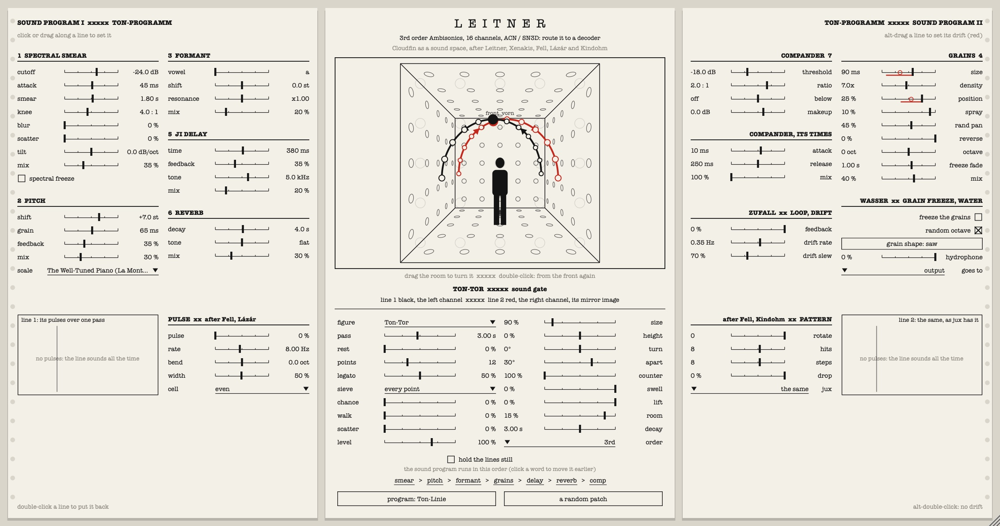

# Leitner

Cloudfin as a sound space. Leitner is the Ambisonics version of [Cloudfin](../README.md), kept in Cloudfin's repository (this folder): the same seven effects, drift and presets, followed by a spatial stage that sends the sound through the room as two lines, after the Ton-Raum work of Bernhard Leitner, with chance, random walks, clouds of points and sieves after Iannis Xenakis, and a pulse layer after Mark Fell, Gábor Lázár and Kindohm.



**[The manual (PDF)](docs/manual/Leitner%20Manual.pdf)**

It is an **encoder**: stereo goes in, Ambisonics come out (ACN channel order, SN3D normalisation, the format of the IEM and SPARTA plug-ins), 3rd to 7th order. It decodes nothing itself.

| Order | Channels |
| --- | --- |
| 3rd (default) | 16 |
| 4th | 25 |
| 5th | 36 |
| 6th | 49 |
| 7th | 64 |

## Routing it to a decoder

1. Put Leitner on a track and give the track as many channels as the order needs (in REAPER: the track's **Route** button, *Track channels*).
2. Pick the same order in Leitner (**order**, bottom of the left sheet).
3. After it, add a decoder at that order with SN3D normalisation, such as the IEM **AllRADecoder** for loudspeakers or **BinauralDecoder** for headphones.

On a track with too few channels for the order you picked, the highest order that fits comes out, and the top of the left sheet says which. On a plain stereo track only a left-right fold of the scene comes out, for checking.

## The space

The left channel is line 1 (black in the drawing) and the right channel is line 2 (red), its mirror image. Nothing counts bars or beats: time is in seconds, and chance can make every pass a different length.

- **figure**: which space the lines draw (the list is below).
- **pass**, **rest**: how long one pass takes, and how much of it is spent waiting at its end.
- **points**, **legato**: Leitner's sound was switched from loudspeaker to loudspeaker, it did not glide. *points* is how many loudspeakers the figure is built from (all the way up: continuous), and *legato* how far each overlaps the next.
- **size**, **height**, **turn**: how big the figure is, how high it sits (0 is ear height) and which way it faces.
- **apart**, **counter**: how far the two lines stand either side of the figure's direction, and how far line 2 runs behind line 1 (100 %: exactly opposite).
- **swell**: louder where the line comes nearest the body. **lift**: thinner as it rises, fuller as it falls.
- **chance**: each pass's length is drawn from an exponential law. **walk**: at every pass the figure takes a Gaussian step in direction and height. **scatter**: each loudspeaker of the raster is thrown off the line, so the line becomes a cloud of points. **sieve**: which loudspeakers of the raster sound at all (unions of residue classes).
- **pulse**, **rate**, **bend**, **width**, **cell**: cut the lines into pulses, each sounding from the one place its line had reached. *rate* runs from rhythm into pitch and *bend* slides it over each pass (after Gábor Lázár); *cell* sets the gaps from a short list of unequal lengths (after Mark Fell).
- **rotate**, **hits**, **steps**, **drop**, **jux**: the cell moves on a step each pass (Fell); a Euclidean pattern, pulses left out by chance, and line 2 playing the pattern backwards, turned, or at twice or half the speed (after Kindohm and TidalCycles).
- **room**, **decay**: one reverb for the whole sphere. **level**: the output. **hold**: stop the lines where they are.

A line can pass through the middle of the room: near the centre the higher orders fade, so the sound spreads round you and then leaves on the other side.

## Programs and your own presets

The **program** button lists Leitner's eighteen programs (each a space with one of Cloudfin's sounds under it; they leave the Ambisonic order alone), then Cloudfin's programs, which change only the sound and leave the space as you have it, then your own. **save this as a preset...** writes everything to a `.leitner` file in your presets folder (`~/Library/Application Support/FreakiePie/Leitner/Presets` on macOS, `%APPDATA%\FreakiePie\Leitner\Presets` on Windows, `~/.config/FreakiePie/Leitner/Presets` on Linux), and **show the presets folder** opens it.

## The figures, and where they come from

| Figure | What it does | After |
| --- | --- | --- |
| Ton-Linie | a straight line across the room, there and back | Leitner's "line of sound"; the Ton-Röhre's leading path |
| Schwingen | a pendulum across you, slowest at the ends | the Ton-Röhre's swinging space (1973) |
| Ton-Liege | to and fro along the body, low | the Ton-Liege sound chair (1975) |
| Ton-Tor | up one side, over the head, down the other | Ton-Tor (1971), one line rising as one falls |
| Vertikal | floor to ceiling and back | the Wand-Raster's vertical lines (1972) |
| Kreis | a ring round you, the two lines in opposite directions | circling, in the Ton-Röhre and Le Cylindre Sonore |
| Soundcube | four circles in turn at four heights | a sheet of the Soundcube project (1969) |
| Spirale | winding up round the body and down | Spiral-Räume (1976) |
| Ton-Würfel | corner to corner of a cube, eight points | Ton-Würfel (1980/81), which had eight loudspeakers; the corner tour is this plug-in's own |
| Erweitern-Verengen | out from the centre and back | Erweitern/Verengen (1977); set *apart* to 90° |
| Wölbung | a vault overhead, rib by rib | his vaults and Doppel-Wölbung (1999); the six ribs are this plug-in's own |
| Paraboloid | straight lines zigzagging between two skew edges, sweeping a curved surface | Xenakis: the glissandi of Metastaseis and the ruled surfaces of the Philips Pavilion |
| Terretektorh | a flat spiral in towards you, faster and faster, and out again | Xenakis: the accelerating rotations of sound in Terretektorh |
| Polytope | eight points thrown over the sphere, new ones every pass | Xenakis: the points of light and sound of the Polytopes |

## The window

It is mirror symmetrical: the room in the middle with the space's controls under it in two facing columns, and a sheet of Cloudfin's sound program either side, the right one reversed. It is drawn after Leitner's 1969 Soundcube sheets: typed sheets, the room in perspective with loudspeakers as small circles on every wall, the sound as a heavy black line with arrows, a solid black figure standing in it. The red of line 2 is after the red rods of his Plexiglas models.

**Drag the room to turn it** and see where things are from any side; double-click it to face front again. Every parameter is a ruled line with a tick: click or drag along it, double-click to put it back. Alt-drag a Cloudfin parameter to set its drift (the red stroke), and a red circle shows where the drift has it now.

## Windows and Linux

Leitner builds as a VST3 and a standalone app on Windows, and as a VST3, an LV2 and a standalone app on Linux; the repository's build workflow makes all three systems' packages. The window is set in American Typewriter on macOS, Courier New on Windows and the system's monospaced face on Linux.

## Build

```sh
cd Leitner
cmake -B build -DCMAKE_BUILD_TYPE=Release
cmake --build build --config Release --target Leitner_All
```

`-DLEITNER_BUILD_TESTS=ON` adds `LeitnerTest`, which checks the harmonics, the encoded directions, the mirror image, the raster, the sieves, chance and every order, and that the window mirrors.

## Credits and notes

- This is an homage. It is not affiliated with or endorsed by Bernhard Leitner or the estate of Iannis Xenakis; no drawing, recording, score or text of theirs is included.
- The pulse layer was written from general knowledge of Mark Fell's, Gábor Lázár's and Kindohm's music and of TidalCycles, not from their patches or code; none of them is affiliated with this plug-in.
- The Xenakis ideas (stochastic durations, random walks, clouds of points, sieves; Metastaseis and the Philips Pavilion, Terretektorh, the Polytopes) were written from general knowledge of his work and *Formalized Music*, not checked against the scores: the three figures are interpretations.
- Sources for the figures and the drawing style: *P.U.L.S.E.* (Hatje Cantz / ZKM, 2008), which reprints his 1977 Sound Space Manifesto and the Soundcube sheets; Sven Sterken, "Architecture without Walls: Bernhard Leitner's Soundcube" (2024); his 2011 lecture "Sound Spaces"; and the work list at bernhardleitner.at.
- The Ambisonic conventions follow the IEM Plug-in Suite and SPARTA, and the room is built like the IEM FdnReverb, as in Pinkie Pie's Balloon Palace, whose Ambisonics code this shares. No code from IEM or SPARTA is included.
- Licence: AGPL v3, as Cloudfin.
