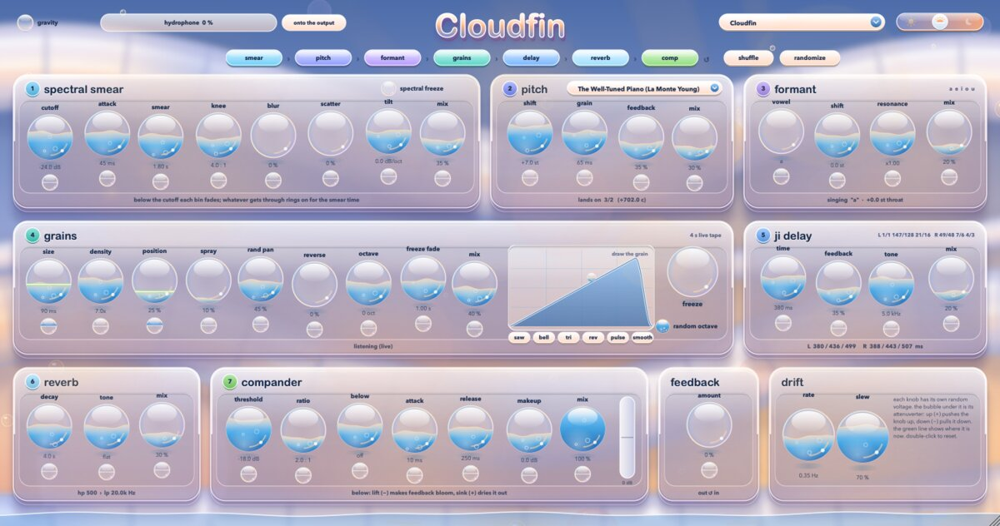

<p align="center"></p>

# Cloudfin

A dreamy, floating multi-effect in a Frutiger Aero look, after a recurring dream of clouds heaped over calm water with light shining through them. The whole window is mirror symmetrical, and shown through a sixteen-colour dithered screen, like a mid-90s display.

Seven effects run one after another, in any order you like: drag the chips under the title to rearrange them. Every knob can drift on its own random voltage, and a feedback loop wraps the whole chain. A hydrophone recording of moving water can play into it or over it. Switch on gravity and every control falls and piles up at the bottom of the window.

- macOS: Audio Unit, VST3 and a standalone app
- Windows: VST3 and a standalone app
- Linux: VST3, LV2 and a standalone app



> **Spatial audio version: [Leitner](Leitner/README.md).** Cloudfin as an Ambisonics encoder (3rd to 7th order, ACN/SN3D, for the IEM and SPARTA decoders): the sound travels through the room as two lines, after Bernhard Leitner's sound spaces. It lives in the [`Leitner`](Leitner) folder of this repository.

**[How to use it: the full help page](docs/HELP.md)**

**[The manual (PDF)](docs/manual/Cloudfin%20Manual.pdf)**: the same guide, also in every download. Your own presets can be saved from the preset menu.

## Download

Get the latest version from the [Releases page](https://github.com/femifleming/Cloudfin/releases/latest):

| System | File |
| --- | --- |
| macOS 11 or later (Apple silicon and Intel) | [Cloudfin-macOS.zip](https://github.com/femifleming/Cloudfin/releases/latest/download/Cloudfin-macOS.zip) |
| Windows 10 or later (64-bit) | [Cloudfin-Windows.zip](https://github.com/femifleming/Cloudfin/releases/latest/download/Cloudfin-Windows.zip) |
| Linux (x86-64) | [Cloudfin-Linux.tar.gz](https://github.com/femifleming/Cloudfin/releases/latest/download/Cloudfin-Linux.tar.gz) |

## Install

### macOS with Homebrew

```sh
brew tap femifleming/cloudfin
brew trust femifleming/cloudfin      # recent Homebrew asks you to trust a tap first
brew install --cask cloudfin
```

If you installed it by hand before, add `--force` to the last line so Homebrew can replace those copies.

This puts the app in `/Applications` and the Audio Unit and VST3 in `~/Library/Audio/Plug-Ins`. Update with `brew upgrade --cask cloudfin`, remove with `brew uninstall --cask cloudfin`.

### macOS by hand

1. Unzip `Cloudfin-macOS.zip`.
2. Copy `Cloudfin.component` to `~/Library/Audio/Plug-Ins/Components` and `Cloudfin.vst3` to `~/Library/Audio/Plug-Ins/VST3`. Put the app anywhere you like, such as `/Applications`.
3. The builds aren't notarised by Apple, so macOS may refuse to open them the first time. Open Terminal and run:
   ```sh
   xattr -dr com.apple.quarantine ~/Library/Audio/Plug-Ins/Components/Cloudfin.component ~/Library/Audio/Plug-Ins/VST3/Cloudfin.vst3 /Applications/Cloudfin.app
   ```
4. In your DAW, rescan plug-ins. In Ableton Live: Settings > Plug-ins, turn on *Use Audio Units v2* and/or *Use VST3 Plug-in System Folders*, then press Rescan. It appears under **FreakiePie**.

### Windows

1. Unzip `Cloudfin-Windows.zip`.
2. Copy `Cloudfin.vst3` to `C:\Program Files\Common Files\VST3`.
3. Rescan plug-ins in your DAW. The standalone `Cloudfin.exe` runs from anywhere. Windows SmartScreen may warn you the first time because the build isn't signed: choose *More info* > *Run anyway*.

### Linux

1. Unpack: `tar -xzf Cloudfin-Linux.tar.gz`
2. Copy the plug-ins into your user folders:
   ```sh
   mkdir -p ~/.vst3 ~/.lv2
   cp -r Cloudfin/Cloudfin.vst3 ~/.vst3/
   cp -r Cloudfin/Cloudfin.lv2 ~/.lv2/
   ```
3. Rescan in your DAW (most Linux DAWs look in these folders). The standalone app runs with `./Cloudfin` and uses ALSA or JACK.

## Build it yourself

You need CMake 3.22 or later and a C++20 compiler (Xcode on macOS, Visual Studio 2022 on Windows, GCC or Clang on Linux).

```sh
git clone --recursive https://github.com/femifleming/Cloudfin.git
cd Cloudfin
cmake -B build -DCMAKE_BUILD_TYPE=Release
cmake --build build --config Release --target Cloudfin_All
```

On macOS and Windows the build also copies the plug-ins into your user plug-in folders (turn that off with `-DCLOUDFIN_COPY_AFTER_BUILD=OFF`). On Linux, install the JUCE dependencies first:

```sh
sudo apt-get install libasound2-dev libjack-jackd2-dev libfreetype-dev libfontconfig1-dev libx11-dev libxcomposite-dev libxcursor-dev libxext-dev libxinerama-dev libxrandr-dev libxrender-dev libxi-dev libegl-dev libgl1-mesa-dev
```

The tests (`-DCLOUDFIN_BUILD_TESTS=ON`) check the sound and drive the whole interface headlessly, saving screenshots as they go.

## Human contributions

Cloudfin's code was written with Claude Code (Anthropic), working under the direction of its author, [femifleming](https://github.com/femifleming). This is what the author brought to it:

- **The original effect chain.** Cloudfin began as a fork of the author's FreakiePie: a spectral gate/smear, a feedback pitch shifter locked to raga and microtonal scales (including La Monte Young's *The Well-Tuned Piano*), a live-buffer granular shifter with randomly slewed size, position and octave, a 500 Hz high-passed FDN reverb and a main feedback loop. It is meant to be live-safe, with no clicks and no latency.
- **The aesthetic and where it comes from.** Frutiger Aero, from a recurring dream; first of a continuous waterslide with light blue light shining through it, now of clouds over water, laid out mirror symmetrically. The knobs are wet and fill with water like bubbles, and float around.
- **The name and the split.** Cloudfin was named by the author and kept as a separate plug-in from FreakiePie.
- **New stages and controls.**
  - A formant filter.
  - A hard-panned stereo 3-tap delay with just-intonation times that follow the pitch shifter's scale.
  - A compander before the feedback stage.
  - Random-slew attenuverters on every parameter.
  - A drawable grain shape, and grain random pan and reverse.
  - A reverb tone control and spectral freeze.
  - Pitch-shifter grain changes that crossfade rather than glide.
- **Reorderable chain, shuffle and randomize.** The effects can be put in any order, with shuffle and randomize buttons.
- **Day, dusk and night.** A darker "water aero sunset" night mode with patches of warm sunlight, a third mode, more depth, and bokeh.
- **Gravity and water.** Controls fall and roll, and shuffle when the window moves. Water gathers at the bottom, and a randomly filtered "sloshy" noise layer runs while gravity is on.
- **The hydrophone recording.** The built-in texture is the author's own stereo hydrophone recording, which can go into the input or onto the output.
- **Presets and sound checks.** The author asked for a set of presets and a UI of at least 30 fps. From listening, they asked that main feedback self-resonate and that the output never clip.
- **The release and the icon.** Builds for macOS, Windows and Linux, a README, help, a Homebrew install, and the plain sky-blue gradient icon (after dropping the fin from it).

## Credits and notes

- The hydrophone recording is original to this project.
- Built with [JUCE](https://juce.com).

## License

Released under the GNU Affero General Public License v3 (see [LICENSE](LICENSE)), as JUCE's free licence requires.
