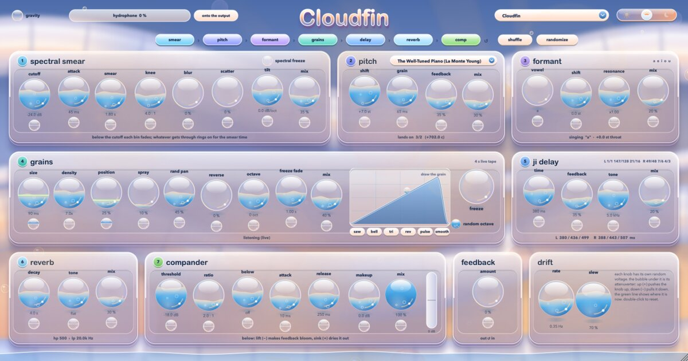
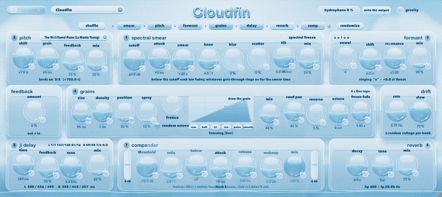
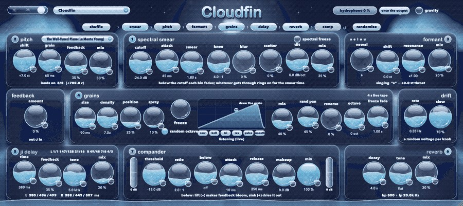
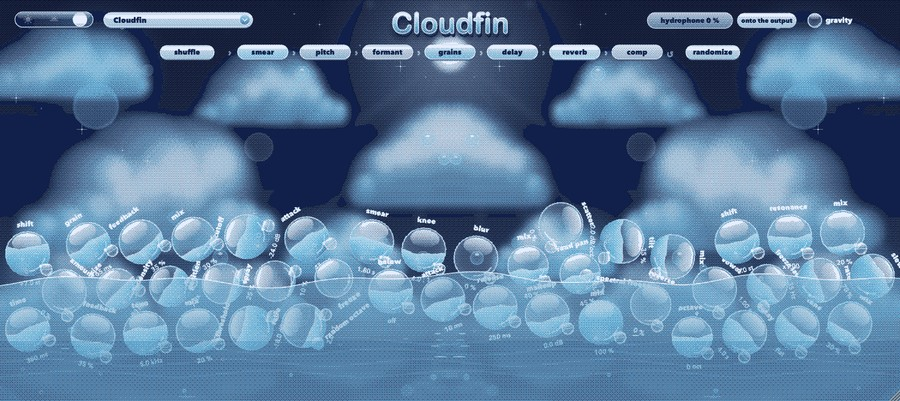

# Cloudfin: help

Cloudfin is a dreamy, floating multi-effect in a Frutiger Aero look, after a recurring dream of clouds heaped over calm water with light shining through them. The window is mirror symmetrical: whatever sits on the left has its twin on the right. It is shown in sixteen colours with a fine dither (each of day, dusk and night has its own sixteen), so soft gradients become a printed-looking pattern while the type stays sharp. Seven effects run one after another, in any order you like, with a feedback loop around them all and a slow random drift that can move every knob on its own.

## Contents

- [The basics](#the-basics)
- [The order of the effects](#the-order-of-the-effects)
- [Spectral smear](#spectral-smear)
- [Pitch](#pitch)
- [Formant](#formant)
- [Grains](#grains)
- [JI delay](#ji-delay)
- [Reverb](#reverb)
- [Compander](#compander)
- [Feedback](#feedback)
- [Drift: every knob moving on its own](#drift-every-knob-moving-on-its-own)
- [Presets, random and the scale](#presets-random-and-the-scale)
- [The hydrophone](#the-hydrophone)
- [Day, dusk and night](#day-dusk-and-night)
- [Gravity](#gravity)

## The basics

Every control is a glass bubble with water inside it: the water level is the value. Drag up or down to turn it, and double-click to put it back to where it started. Each effect has a *mix* knob, and an effect with its mix at zero is out of the way.

In the bottom corner of each knob sits a smaller bubble, its attenuverter, which belongs to the drift (see below).

## The order of the effects

The row of chips under the title is the signal path, left to right: smear, pitch, formant, grains, delay, reverb, comp. Drag a chip along the row to move that effect somewhere else in the chain. *Shuffle*, at the left end of the strip, picks a random order, and double-clicking the strip puts it back. Every change crossfades through a short 20 ms dip, so it never clicks, and the order is saved with your session.

The numbers on the panels follow the order, so you can always see which effect hears which.

## Spectral smear

The sound is split into hundreds of frequency bins. Below the *cutoff* each bin fades away, and whatever gets through rings on for the *smear* time, so the sound melts into long, smooth tones. *Attack* sets how quickly an opening bin swells up and *knee* how gently the bins below the cutoff fade. *Blur* smooths the smeared spectrum across neighbouring bins, *scatter* throws the phases about until tones dissolve into breath, and *tilt* leans the whole thing darker or brighter.

*Spectral freeze* holds the spectrum exactly as it is, for as long as it's on.

## Pitch

*Shift* moves the sound up or down, snapped to the scale chosen in the menu on the pitch panel; the panel tells you which note of the scale it lands on. *Grain* sets the size of the shifter's window (short is glassy, long is smooth) and *feedback* sends the shifted sound round again, so it climbs or falls a step at a time.

## Formant

A singing throat. *Vowel* glides through a, e, i, o and u, *shift* moves the throat up or down without changing the pitch, and *resonance* makes the vowel sharper and more whistling.

## Grains

Cloudfin keeps the last four seconds on a live tape and plays it back as grains. *Size* and *density* set how long each grain is and how many overlap. *Position* picks where on the tape they read from and *spray* scatters them around it. *Rand pan* spreads them across the stereo field, *reverse* flips some of them backwards and *octave* moves them up or down (or let *random octave* choose for each grain).

Draw the shape of a grain in the box with the mouse, or pick one of the ready shapes underneath it. *Freeze* holds the tape still and *freeze fade* sets how slowly it slides in and out of the freeze.

## JI delay

A stereo delay with three taps a side, hard-panned left and right. The taps are tuned in just intonation to the note the pitch shifter lands on, so the echoes form a chord with it; the panel shows the ratios and times. *Time* scales them all, *feedback* sets how long they repeat and *tone* darkens them.

## Reverb

*Decay* sets how long the space rings. *Tone* runs from a lowpass (dark, below the middle) to a highpass (airy, above it), shown at the bottom of the panel.

## Compander

A compressor that can also lift quiet sounds. *Threshold* and *ratio* work as on any compressor, with *attack*, *release* and *makeup*. *Below* acts on everything under the threshold: lift it (−) and quiet tails swell up, which makes feedback bloom; sink it (+) and the sound dries out. The little glass column at each end of the row shows how much it's turning the sound up or down (the two show the same thing).

## Feedback

*Amount* takes the end of the chain back to its start, so the whole of Cloudfin can ring on by itself. It is level-riding and tamed so it sings without blowing up.

## Drift: every knob moving on its own

Each knob has its own slow random voltage. The small bubble in the bottom corner of a knob is its attenuverter: push it up (+) and the voltage moves the knob up, pull it down (−) and it moves the knob down, leave it in the middle and the knob stays still. A green line on the knob shows where it is right now. *Rate* sets how fast the voltages wander and *slew* how smoothly they glide.

## Presets, random and the scale

The menu at the top left holds the presets. At the bottom of it, *save this as a preset...* keeps everything as it is now under a name of your choosing; your own presets then appear in the menu under *yours*, and *show the presets folder* opens where they are kept (they are ordinary files, so you can copy, rename or delete them there). *Randomize* makes a new patch with every control somewhere new. The pitch panel's menu picks the scale that the pitch shifter and the JI delay follow, from Western modes to ragas, maqams and just-intonation tunings.

## The hydrophone

The capsule at the top right plays a hydrophone recording of moving water. Drag it to set how loud it is (double-click to switch it off). The button next to it sends it *onto the output*, on top of everything, or *into the input*, so it goes through all the effects with your sound.

## Day, dusk and night

The switch at the top left changes the light: day, dusk (the default) or night. It's saved with your session. The sky, the clouds and the sea drift behind the glass as you move the mouse.

## Gravity

Turn on *gravity* (top right) and every control falls, rolls and piles up at the bottom of the window, with a slosh of water to go with it. Move the plug-in window and they tumble. Turn it off and they float home. Everything still works while they're piled up.

---
[Back to the README](../README.md)
